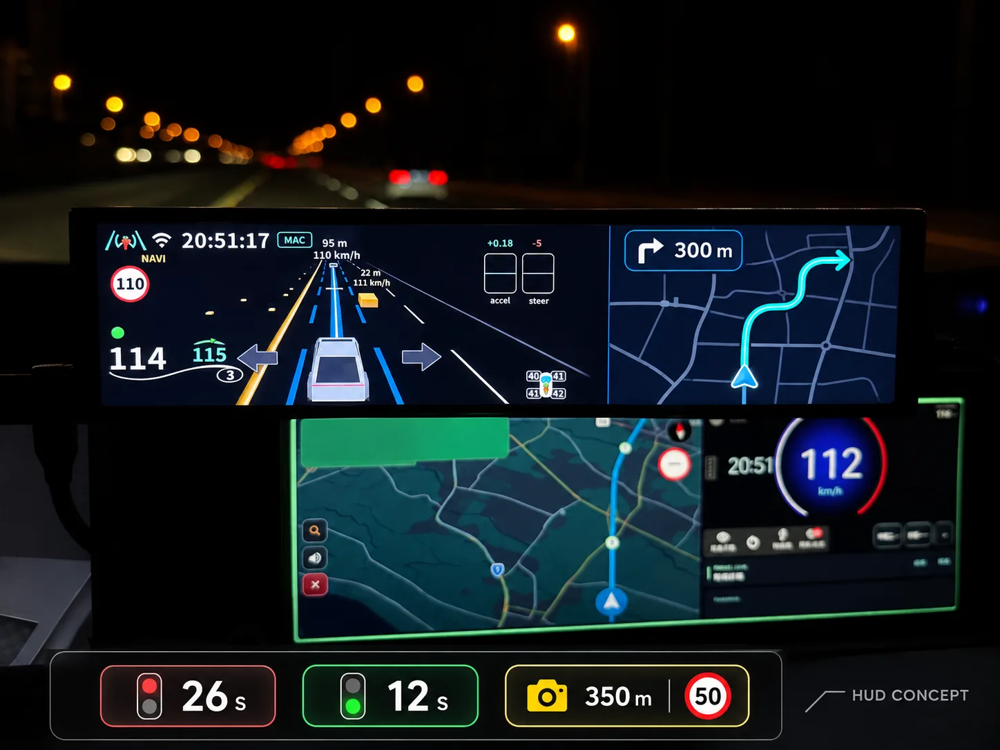
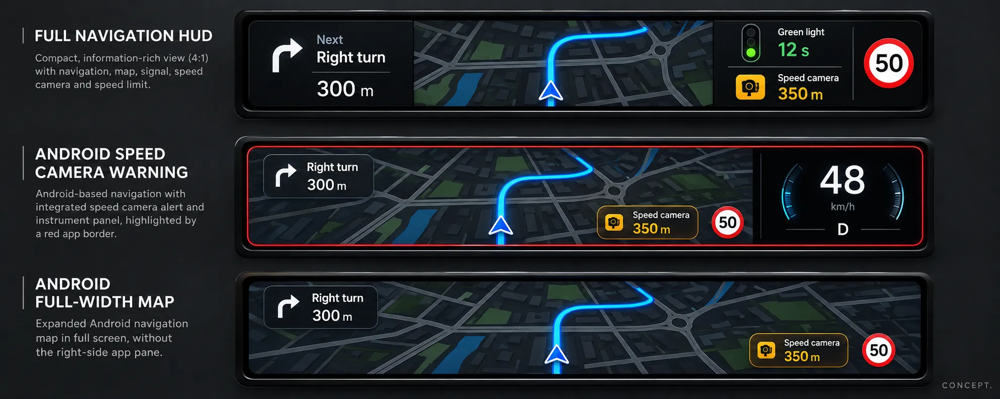

# Carrot Bridge wide.74｜HUD 畫面與地圖來源對照

[下載 wide.74 測試 APK](https://github.com/FANHAOHSIANG/Carrot-Bridge/releases/tag/wide.74) · [Android 試作分支](https://github.com/FANHAOHSIANG/Carrot-Bridge/tree/test/android-amap-hud-video/variants/hud-map-video) · [Carrot 測試分支安裝](C4_TEST_INSTALL_zh-TW.md)

## 想看到圖中的效果，要選哪個地圖？

**想同時看高德原生地圖和路線、號誌倒數，以及 Android 四周測速紅光，先選「高德車機版」。** 在 Carrot Bridge 的「分區一」選高德車機版，開始投屏與導航，勾選「HUD 地圖影像（測試）」。HUD 用模式 **7** 看駕駛畫面加右側地圖，或用模式 **6** 看全導航。

| 想看到的效果 | 在 Carrot Bridge 選哪個來源 | 顯示條件 |
| --- | --- | --- |
| HUD 顯示高德原生底圖和實際導航路線 | **高德車機版**或**高德一般版** | 啟動投屏及導航，再勾選「HUD 地圖影像（測試）」。 |
| 高德地圖上顯示紅／綠燈倒數 | **高德車機版**優先；**高德一般版**可轉送原畫面已有的倒數 | 取決於高德是否在該路口、該行向顯示秒數。 |
| HUD 獨立顯示大字紅／綠燈倒數 | **高德車機版**優先驗收 | 車端須收到明確燈色、方向和有效秒數，且 HUD 版本須支援。高德一般版 Link 若只提供秒數，獨立提示維持中性。 |
| Android 畫面四周測速紅光 | **高德車機版** | 高德給出有效相機速限與距離時，500 公尺內可觸發。高德一般版 Link 的相機欄位仍待驗證。 |
| HUD 獨立顯示測速限速與剩餘距離 | **高德車機版**優先驗收 | comma 須收到有效相機資料。高德投屏裡看得到測速標誌時，該標誌也可跟著影像顯示。 |
| HUD 顯示 Google 的地圖、導航路線與轉彎提示 | **內建 Google 導航 NOO** | 用內建導航規劃並開始導航。高德式號誌倒數與四周測速紅光在此來源尚未驗證。Google 地圖「僅投屏」另有模式，只顯示投屏畫面。 |

## wide.74 示意圖

模式 7 保留左側車道／車況，右側放導航圖。圖底三張卡分別展示紅燈 26 秒、綠燈 12 秒和前方 350 公尺的限速 50 測速提示。地圖、距離與秒數均為示意；同一個方向的紅燈、綠燈分開驗收。

| 功能 | wide.74 操作與顯示 |
| --- | --- |
| 高德原畫面送 HUD | 分區一選高德車機版或一般版，啟動投屏與導航，勾選「HUD 地圖影像（測試）」。開關預設關閉。最多 5 FPS，影像包含高德畫面上實際出現的路線和提示。 |
| Android 測速紅光 | 高德車機版提供有效相機速限與距離時，可在 500 公尺內觸發 App 四周紅光。事件超過 2.6 秒未更新或切換來源會清除。一般版 Link 測速欄位仍待確認。 |
| HUD 測速提示 | 車端收到有效相機資料時，可由 HUD 繪製限速圓牌與剩餘距離。高德影像內的測速標誌與 HUD 獨立提示各走自己的資料路徑。 |
| HUD 紅／綠燈倒數 | 高德畫面已顯示的倒數可隨影像送出。車端另收到明確燈色、方向和有效秒數時，才會依 HUD 版本繪製彩色獨立提示；高德一般版 Link 只有中性秒數時維持中性。 |
| Android 地圖全幅 | **分區一是左側導航，分區二是右側神盾或其他 App。** 在分區選單選「關閉分區二」讓地圖全幅，從地圖右下角「⋯ → 顯示分區二」復原。 |
| HUD 模式 6／7 | **6** 是外部導航全畫面，**7** 是左側駕駛畫面、右側導航。若地圖影像未到，支援的版本可依現有資料退回路線線條或轉彎箭頭。車端目前的繪圖程式也有在模式 **1（偵錯）**、**5（行程報告）** 疊加號誌及測速提示的路徑，這兩個模式保留原資訊區，其實機顯示仍待驗證。 |

## 分支與接法

| 元件 | 建議搭配 |
| --- | --- |
| Android | [Carrot Bridge wide.74 預發行版](https://github.com/FANHAOHSIANG/Carrot-Bridge/releases/tag/wide.74)，已用原簽章發布，可覆蓋 wide.73。 |
| 官方 Carrot | [ajouatom/openpilot 的 `carrot-wip`](https://github.com/ajouatom/openpilot/tree/carrot-wip) 可先驗基本 Navi v2 導航與外接 HUD 設定。高德 JPEG 與彩色倒數的完整體驗仍依實際車端版本。 |
| 個人 Carrot 測試分支 | [`test/carrot-wip-upstream-20261104`](https://github.com/FANHAOHSIANG/openpilot-carrot/tree/test/carrot-wip-upstream-20261104)，有導航畫面備援、號誌及測速顯示程式。本文核對到 `320893db`。與 Android 的試作分支是兩個不同的儲存庫。 |
| USB 直連／Mac 轉接 | 直連由 comma 輸出到相容的 TURZX。Mac 路徑由 [CarrotMacHUD](https://github.com/FANHAOHSIANG/carrotMAC-HUD) 接收後繪圖輸出，須使用支援 Navi v2 地圖影像的 HUD 版本。兩種接法與兩個高德來源均待實機驗收。 |

## Carrot Web 建議設定

停車，讓 Android、comma 及使用中的 Mac 可以互通。用同網路的瀏覽器開 `http://<comma 的區網 IP>:7000`，進 Carrot Web「設定 → carrotpilot → 顯示 → 外接 HUD」。App 對 comma 的 Navi v2 連線走 TCP 7714。

| 設定 | 初次建議 |
| --- | --- |
| 外接 HUD 啟用 `ClusterHud` | comma USB 直連 TURZX 設 **1**。Mac 轉接在 Jetlink／CarrotMacHUD 確認接收與輸出。 |
| 外接 HUD 畫面模式 `ClusterHudScreenMode` | 先用 **7** 看車道與右側地圖，再用 **6** 看全導航。 |
| HUD 左右配置 `ClusterHudPanelLayout` | **0** 保留駕駛畫面靠左，資訊靠右。 |
| 導航地圖主題／種類 | 支援該參數的渲染來源可用 `ClusterNaviMapTheme=1` 深色、`ClusterNaviMapType=0` 一般地圖。若用高德投屏影像，夜間外觀在高德內調整。 |
| 導航地圖 FPS `ClusterNaviMapFps` | 可先保留 **1（10 FPS）**。wide.74 高德 JPEG 發送端最多 **5 FPS**；調高車端參數仍受發送端上限限制。 |
| HUD 偵錯 `ClusterHudDebug` | 平時 **0**。停車需要讓 HUD 保持亮著可用 **1**，驗收完恢復日常設定。 |
| ATC、導航減速與 OSM | 純驗收顯示時沿用既有控制設定。要另外設定導航減速或 ATC，按 [官方 Carrot 設定](CARROT_SETTINGS_zh-TW.md) 逐項核對。 |

驗收時分別用兩版高德開始導航，確認模式 7 和 6 都看到同一條選定路線。接著關閉影像開關、停止導航或切換地圖，確認舊影像清除。測試版請先停車驗收，兩張圖均為示意，尚無對應的 wide.74 實機截圖。

參考：[官方 Carrot Web 設定表](https://github.com/ajouatom/openpilot/blob/baab16bb9666eb51a5047aaa586e4517c6155a40/openpilot/selfdrive/carrot_settings.json) · [測試分支 HUD 繪圖](https://github.com/FANHAOHSIANG/openpilot-carrot/blob/320893db2f3ee2df9182c0b1e4f1dc8bea84d572/openpilot/selfdrive/carrot/cluster/cluster_renderer.py) · [wide.73 測速紅光](https://github.com/FANHAOHSIANG/Carrot-Bridge/blob/wide.74/variants/wide73/README.md)
